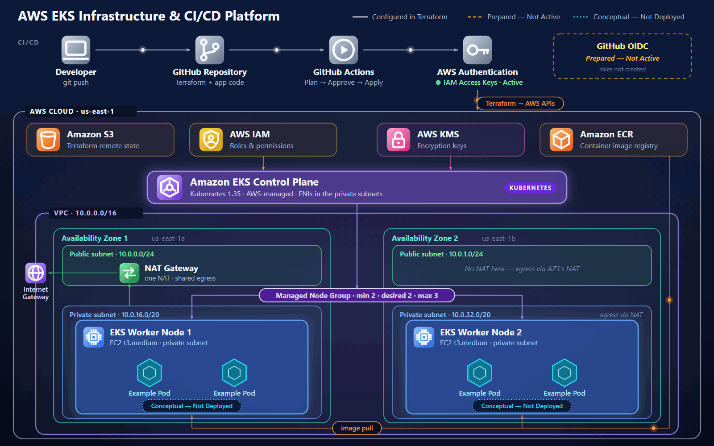

# 🚀 AWS EKS Infrastructure & CI/CD Platform

<p align="center">
  
</p>

<p align="center">
  
  
  
  
  
  
</p>

---

## 🏗️ Architecture

<p align="center">
  <a href="docs/architecture.gif"></a>
</p>

<p align="center">
  <a href="docs/architecture.gif">Open full-size GIF</a>
</p>

> The diagram shows what the Terraform in this repository **defines**. Nothing has been deployed or verified in AWS yet, GitHub OIDC is prepared but **not active** (Terraform CI uses IAM user access keys), and no Kubernetes workloads exist.

### 🎨 Architecture Legend

| Marker | Meaning |
|---|---|
| Solid box or line | Configured in Terraform (or in the workflows) |
| White flow | Developer → GitHub → GitHub Actions → AWS authentication (IAM access key) |
| Orange flow | Terraform calling AWS APIs; container image pull (ECR → worker nodes) |
| Purple flow | EKS control plane → managed node group |
| Amber dashed | Not used: GitHub OIDC is prepared in Terraform, but authentication uses the GitHub Actions access key |
| Cyan dotted | Conceptual, not deployed (example pods) |

### Key Architecture Features

- Multi-AZ network architecture.
- Public and private subnet separation.
- Private EKS worker nodes.
- Centralized IAM roles. GitHub Actions currently authenticates to AWS with IAM user access keys stored as repository secrets; GitHub OIDC roles are prepared in Terraform but not active.
- Private ECR image registry.
- Encrypted Terraform remote state.
- KMS-based encryption integration.

## 📌 Project Overview

This project demonstrates the design and implementation of an AWS Elastic Kubernetes Service (EKS) infrastructure platform using **Terraform** and **GitHub Actions**.

The infrastructure is designed around a modular Infrastructure as Code approach, with a focus on cloud networking, Kubernetes infrastructure, IAM permissions, container image management, remote Terraform state, and automated infrastructure workflows.

The project provides a practical environment for learning AWS cloud infrastructure and DevOps engineering concepts.

> 📖 Detailed setup, permission and workflow documentation: **[docs/OPERATIONS.md](docs/OPERATIONS.md)**

## 🛠️ Tools & Technologies

| Category | Technology | Purpose |
|---|---|---|
| Cloud Provider | AWS | Cloud infrastructure |
| Infrastructure as Code | Terraform | Provisioning and managing infrastructure |
| Container Orchestration | Amazon EKS | Managed Kubernetes cluster |
| Container Registry | Amazon ECR | Private container image storage |
| Networking | Amazon VPC | Public and private network architecture |
| Identity & Access | AWS IAM | Roles and permissions |
| Encryption | AWS KMS | Encryption key management |
| CI/CD | GitHub Actions | Automated workflows |
| Authentication | AWS Access Keys | AWS authentication using IAM access key credentials |
| Remote State | Amazon S3 | Terraform state storage |
| State Locking | Terraform S3 Lockfile | State concurrency protection |
| Version Control | Git & GitHub | Source code management |

## ⚙️ Infrastructure Components

### 1. Networking — Amazon VPC

- Custom VPC.
- Two Availability Zones.
- Public and private subnets.
- Internet Gateway.
- NAT Gateway.
- Route tables and subnet associations.
- Kubernetes subnet tagging.

### 2. Kubernetes — Amazon EKS

- Managed EKS control plane.
- Private worker nodes.
- Managed node group.
- Configurable node scaling.
- Encrypted worker node storage.
- IMDSv2 configuration.
- Kubernetes control plane logging.
- KMS secrets encryption.

### 3. Container Registry — Amazon ECR

- Private ECR repository.
- Image tag immutability.
- Image scanning on push.
- AWS-managed encryption.
- Lifecycle policy for untagged images.

### 4. Identity & Access Management — IAM

- EKS cluster IAM role.
- EKS worker node IAM role.
- GitHub Actions IAM identities (an IAM user for Terraform and optional OIDC roles for the application pipeline).
- Separate infrastructure and deployment permissions.
- Scoped IAM permissions.
- OIDC trust relationships.

### 5. Terraform Remote State

- S3 backend.
- Bucket versioning.
- Server-side encryption.
- Public access blocking.
- TLS-only access policy.
- Native S3 state locking.

## 🔄 Implementation Steps

The project was organized and implemented through the following stages:

### Step 1 — Project Structure

Created a modular Terraform project structure to separate infrastructure resources and improve maintainability.

### Step 2 — Remote State Bucket

Prepared a Terraform bootstrap configuration for the S3 state bucket. The bucket itself (`moh-terraform-state-2026-uniq`, us-east-1) was created manually through the AWS Console, so the bootstrap configuration is kept for reference only and is not run.

### Step 3 — AWS Networking

Designed the VPC architecture with two Availability Zones, public subnets, private subnets, routing, and NAT connectivity.

### Step 4 — Amazon ECR

Defined a private container registry with image scanning, immutable tags, and lifecycle management.

### Step 5 — IAM Configuration

Created separate IAM roles and policies for EKS infrastructure and GitHub Actions workflows.

### Step 6 — Amazon EKS

Configured the managed Kubernetes cluster and private worker node group.

### Step 7 — Encryption & Security

Integrated KMS encryption, encrypted worker node volumes, restricted API access configuration, and IAM-based access.

### Step 8 — GitHub Actions CI/CD

Prepared separate workflows for Terraform infrastructure operations and the EKS deployment pipeline.

### Step 9 — Terraform Validation

Performed local Terraform formatting, initialization, and configuration validation.

## 🔁 CI/CD Workflow

The repository contains two GitHub Actions workflows.

### Terraform Infrastructure Workflow (`terraform.yml`)

Started manually only (`workflow_dispatch`); it never runs on push or pull request.

```text
Workflow Dispatch (manual)
       |
       v
Terraform Init
       |
       v
Terraform Validate
       |
       v
Terraform Plan
       |
       v
Saved Plan Artifact (unencrypted, 1-day retention)
       |
       v
Production Environment Approval
       |
       v
Terraform Apply (exact saved plan)
       |
       v
Terraform Outputs
```

### EKS Deployment Workflow (`eks-cicd.yml`)

```text
Code Push to main  (pull requests run the first three stages only)
    |
    v
Validate
    |
    v
Build Container Image
    |
    v
Security Scan
    |
    v
AWS Authentication (OIDC role prepared, not yet provisioned)
    |
    v
Push Image to Amazon ECR
    |
    v
Production Environment Approval
    |
    v
Deploy to EKS (image pinned by digest)
```

*The application deployment workflow is prepared as a pipeline design; the application source, Dockerfile, and Kubernetes manifests are not yet included in the current project.*

## 📁 Project Structure

```text
first-terraform-aws-eks-cicd-platform/
│
├── .github/
│   └── workflows/
│       ├── terraform.yml
│       └── eks-cicd.yml
│
├── docs/
│   ├── architecture.gif   (animated architecture diagram)
│   └── OPERATIONS.md
│
├── terraform/
│   ├── bootstrap/            (reference only: the state bucket was created manually)
│   │   ├── .terraform.lock.hcl
│   │   ├── versions.tf
│   │   ├── variables.tf
│   │   ├── main.tf
│   │   └── outputs.tf
│   │
│   ├── modules/
│   │   ├── vpc/
│   │   │   ├── main.tf
│   │   │   ├── variables.tf
│   │   │   └── outputs.tf
│   │   ├── ecr/
│   │   │   ├── main.tf
│   │   │   ├── variables.tf
│   │   │   └── outputs.tf
│   │   ├── eks/
│   │   │   ├── main.tf
│   │   │   ├── variables.tf
│   │   │   └── outputs.tf
│   │   └── iam/
│   │       ├── main.tf
│   │       ├── variables.tf
│   │       ├── outputs.tf
│   │       ├── eks_roles.tf
│   │       ├── eks_secrets_kms.tf
│   │       ├── admin_policy.tf
│   │       ├── github_actions.tf
│   │       ├── github_deploy_policy.tf
│   │       ├── github_oidc.tf
│   │       └── github_oidc.tf.example
│   │
│   ├── .terraform.lock.hcl
│   ├── versions.tf
│   ├── providers.tf
│   ├── backend.tf
│   ├── variables.tf
│   ├── main.tf
│   ├── outputs.tf
│   ├── backend.hcl.example
│   └── terraform.tfvars.example
│
├── .gitignore
└── README.md
``````

## 🚀 Deployment Guide

### Prerequisites

Install the following tools:

- AWS CLI
- Terraform
- Git
- GitHub account
- AWS account

### 1. Clone the Repository

```bash
git clone https://github.com/sabo1166/first-terraform-aws-eks-cicd-platform.git

cd first-terraform-aws-eks-cicd-platform
```

### 2. Configure AWS Credentials

Configure your AWS CLI credentials locally:

```bash
aws configure
```

Verify your AWS identity:

```bash
aws sts get-caller-identity
```

### 3. State Bucket (already created)

The S3 bucket for Terraform remote state, `moh-terraform-state-2026-uniq` in `us-east-1`, was **created manually through the AWS Console**. Terraform only uses it as the backend and never creates it, so `terraform/bootstrap/` is not needed for this bucket. Do not run it.

In the AWS Console, confirm the bucket has **Versioning enabled** (new buckets have it off), default encryption on, and **Block all public access** on.

### 4. Configure Variables

```bash
cd terraform
cp terraform.tfvars.example terraform.tfvars  # set public_access_cidrs
```

`public_access_cidrs` is required: it lists who may reach the public EKS API endpoint (for example your IP as `x.x.x.x/32`), and `0.0.0.0/0` is rejected. The generated file is git-ignored. The state bucket name is already set in `backend.tf` (and is the default of `tfstate_bucket_name`), so no `backend.hcl` is needed.

### 5. Initialize Main Terraform Configuration

```bash
terraform init
```

`init` connects to the existing bucket. No local state exists, so nothing needs to be migrated; if `init` ever asks to copy existing state, stop and check before answering.

### 6. Validate Infrastructure

```bash
terraform fmt -check -recursive

terraform validate
```

### 7. Review Infrastructure Plan

```bash
terraform plan
```

Review all planned resources and estimated costs before approving an infrastructure deployment. The first apply creates IAM, KMS and networking resources and is performed by an administrator; see [docs/OPERATIONS.md](docs/OPERATIONS.md) for the Admin/CI permission boundary and the GitHub setup.

## 🧪 Validation & Testing

The following local checks were completed:

| Check | Result |
|---|---|
| Terraform formatting | Passed |
| Terraform initialization without backend | Passed |
| Terraform validation | Passed |
| GitHub Actions workflow YAML parsing | Passed |
| Module organization | Reviewed |
| AWS deployment | Not yet verified |
| EKS workload deployment | Not yet verified |

**Important:** Successful Terraform validation confirms that the local configuration is syntactically and structurally valid. It does not guarantee that AWS deployment or IAM permissions will work successfully.

## 🔐 Security Considerations

The infrastructure configuration incorporates several security practices:

- Private worker nodes.
- Restricted EKS API endpoint configuration.
- IAM roles and scoped policies.
- Optional GitHub OIDC configuration (prepared in Terraform, not active).
- Terraform plan artifact verified by SHA-256 (the artifact is **not encrypted** and may contain sensitive values; keep the repository private, see `docs/OPERATIONS.md`).
- S3 public access blocking.
- TLS-only S3 access.
- KMS encryption integration.
- ECR image scanning.
- Encrypted worker node volumes.

GitHub Environment protection rules and AWS permissions must be configured and verified before relying on deployment approvals.

**Current limitations:**

- The Terraform workflow uses long-lived IAM user access keys stored as repository secrets; migrating it to OIDC is planned.
- The `production` approval gate exists only once the GitHub Environment is configured with required reviewers.
- The Terraform CI identity can still manage EKS cluster access settings.
- **The Terraform CI IAM user has the AWS-managed `AdministratorAccess` policy attached** (`grant_ci_administrator_access = true`, once an administrator applies it). Anyone with its access keys, or who can change the workflow or Terraform code, has full administrative control of the AWS account. The explicit self-protection denies and the `production` manual approval remain; see `docs/OPERATIONS.md` "AWS permissions".

## 💰 Cost Considerations

This architecture can generate AWS charges even when no workloads are running.

Potential cost sources include:

- EKS cluster control plane.
- EC2 worker nodes.
- NAT Gateway and data processing.
- EBS volumes.
- KMS keys.
- CloudWatch logs.
- ECR image storage.
- S3 storage.

Always review the AWS pricing calculator and Terraform plan before deployment. Destroy lab resources when they are no longer needed.

## 🧹 Cleanup

When you finish experimenting, review the resources and dependencies before removing them.

For Terraform-managed infrastructure:

```bash
terraform plan -destroy
```

Only after reviewing the destruction plan and explicitly deciding to proceed:

```bash
terraform destroy
```

**Warning:** The Terraform backend bucket and its state files require separate consideration. Do not delete the state backend before safely removing the infrastructure that depends on it.

## 🎯 Learning Objectives

This project provides hands-on practice with:

- Infrastructure as Code.
- AWS networking.
- Amazon EKS architecture.
- Kubernetes infrastructure.
- IAM roles and policies.
- GitHub Actions CI/CD.
- OIDC authentication.
- Amazon ECR.
- Terraform remote state.
- Cloud security fundamentals.

## 📌 Project Status

**Experimental Learning Project**

The Terraform infrastructure configuration has passed local formatting and validation checks. Actual AWS provisioning, Kubernetes workload deployment, and end-to-end CI/CD execution remain unverified.

## 👨‍💻 Author

**Mohammed Gamal Al Jaafari**

Cloud Engineering | AWS | Terraform | DevOps

- GitHub: [sabo1166](https://github.com/sabo1166)
- LinkedIn: [Your LinkedIn Profile](YOUR_LINKEDIN_URL)

---

<p align="center">
  <b>Building, Learning, and Engineering on AWS ☁️</b>
</p>
